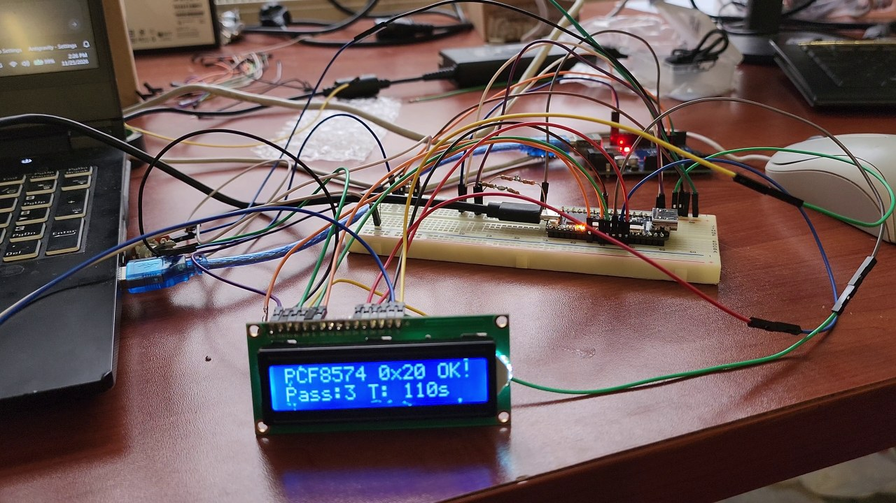
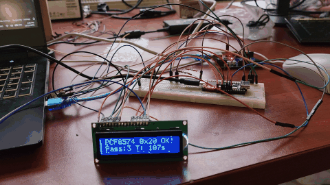
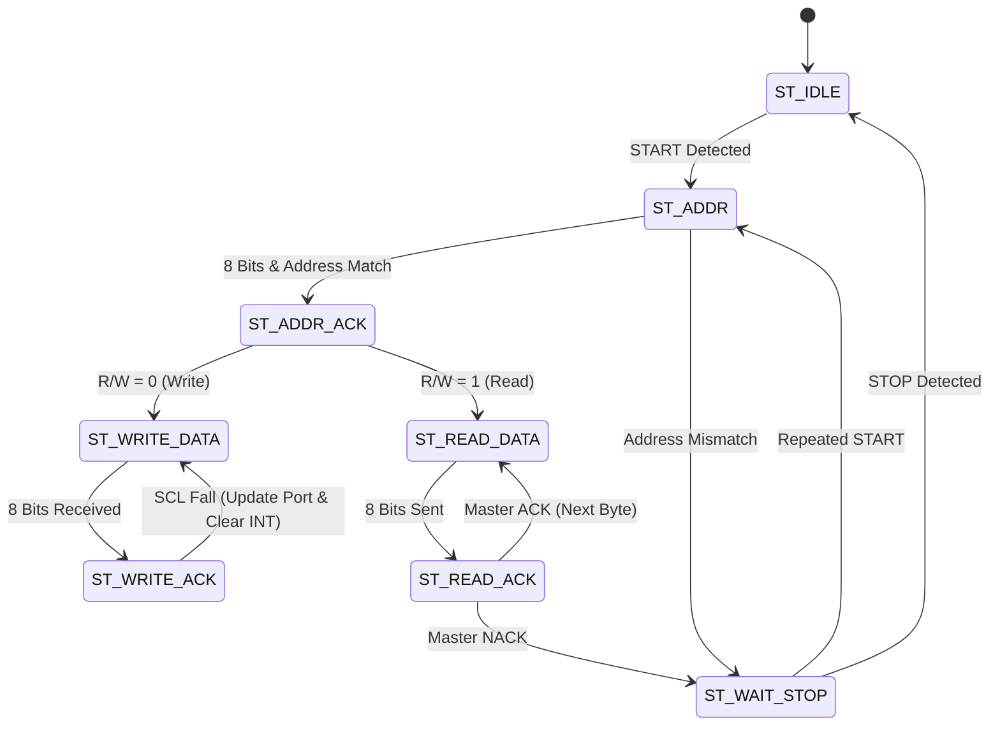

# PCF8574 / PCF8574A Remote 8-Bit I2C I/O Expander in VHDL (FPGA Verified)

A complete, synthesizable **VHDL** hardware implementation of the **NXP PCF8574 / PCF8574A** Remote 8-Bit I/O Expander for the I2C bus, verified both in **GHDL simulation** (10/10 self-checking tests) and on **real FPGA hardware** (**Sipeed Tang Nano 20K**, Gowin `GW2AR-18`) driving a live **1602 Character LCD** from an **Arduino Uno** over I2C at **100 kHz** and **400 kHz**.



---

## Live Hardware Demo

*Tang Nano 20K acting as a physical PCF8574 I2C slave (`0x20`), bridging I2C commands from an Arduino Uno to a 1602 parallel LCD in 4-bit mode with live onboard diagnostic LEDs:*



---

## Key Features

- **Full I2C Slave Engine (100 kHz Standard & 400 kHz Fast Mode):**
  - Automatic detection of `START`, `STOP`, and `Repeated START` conditions.
  - Strict 7-bit hardware address decoding supporting `A0, A1, A2` pins and parameterized `ADDR_PREFIX` (`"0100"` for **PCF8574** `0x20–0x27`, `"0111"` for **PCF8574A** `0x38–0x3F`).
  - Supports single-byte and consecutive multi-byte streaming reads and writes.
- **Metastability-Safe Input Conditioning ([rtl/i2c_filter.vhd](rtl/i2c_filter.vhd)):**
  - Dedicated **2-FF CDC synchronizer** (`sync_ff1 -> sync_ff2`) isolating metastability before a configurable shift-register glitch filter (`FILTER_DEPTH`) on `SCL`, `SDA`, and all 8 `P0–P7` pins.
- **Quasi-Bidirectional I/O Ports (`P0–P7`):**
  - True open-drain NMOS low drive + High-Z input sensing without a direction register.
  - Power-On Reset (POR) initializes all ports to `0xFF`.
  - Optional NXP-style **`0 → 1` transient strong-HIGH boost pulse** (`ENABLE_RISE_BOOST => true`) for crisp rising edges across breadboard capacitance.
- **Datasheet-Accurate Interrupt Output (`INT_N`):**
  - Active-low open-drain interrupt triggered on any rising or falling edge on input-configured pins (`port_reg = '1'`).
  - Automatically clears on pin reversion, Read ACK (`SCL` rising), or Write ACK (`SCL` falling).
- **Clean IP vs. Board Wrapper Separation:**
  - Pure, board-agnostic IC core in `rtl/` + dedicated Sipeed Tang Nano 20K wrapper, `.cst` pinout, and `.sdc` timing constraints in `fpga/tang_nano_20k/`.

---

## I2C Slave State Machine



---

## FPGA Implementation Results (Tang Nano 20K — `GW2AR-LV18QN88C8/I7`)

Synthesized and placed-and-routed in **Gowin EDA V1.9.11.03** with **0 errors**, **0 synthesis warnings**, **0 inferred latches**, and SDC timing closure at **27 MHz** (`tang_nano_20k.sdc`):

| Metric | Pure `pcf8574` IP | Full `pcf8574_tang20k_top` (IP + POR + Boost + 6 LEDs) |
| :--- | :---: | :---: |
| **LUT4** | 114 / 20,736 (< 1%) | 320 / 20,736 (2%) |
| **Flip-Flops** | 108 / 15,750 (< 1%) | 253 / 15,750 (2%) |
| **Latches** | 0 | 0 |
| **BSRAM** | 0 / 46 | 0 / 46 |
| **I/O Ports** | 16 | 21 |

---

## Verification

### 1. GHDL Self-Checking Simulation (10/10 Passed)
Run the automated testbench verifying POR defaults, address rejection, write/read, quasi-bidirectional loading, interrupt generation & all 3 clearing conditions, PCF8574A (`0x39`), and Repeated START:

```powershell
cd sim
.\run_sim.ps1
```

### 2. Real Hardware Verification (Arduino Uno + Tang Nano 20K + 1602 LCD)
Tested using [sw/arduino_test_suite/arduino_test_suite.ino](sw/arduino_test_suite/arduino_test_suite.ino) and [sw/arduino_lcd_demo/arduino_lcd_demo.ino](sw/arduino_lcd_demo/arduino_lcd_demo.ino):
- **Strict 7-bit Address Scan (`0x01–0x7F`):** Only `0x20` acknowledged (`[PASS]`).
- **Quasi-Bidirectional Write & Read-Back (100 kHz):** All free pins matched; `P1` (wired to GND via LCD `RW`) faithfully read back `0` on High-Z writes, confirming genuine external input sensing.
- **Consecutive Multi-Byte Streaming Write & Read:** `[PASS]`.
- **400 kHz Fast Mode Write & Read-Back (`0xA5`):** `[PASS]`.
- **1602 Character LCD (4-bit mode):** Live text and ticking counter verified on hardware.

---

## Tang Nano 20K Wiring Table

> **Voltage Note:** Tang Nano 20K I/O banks are **3.3V** (not 5V tolerant). Both Arduino sketches disable AVR internal 5V pull-ups (`pinMode(A4/A5, INPUT)`); connect external **4.7 kΩ pull-ups to 3.3V** on `SCL` and `SDA`.

| Signal | Tang Nano 20K Pin | Connection |
| :--- | :---: | :--- |
| `clk` | Pin `4` | Onboard 27 MHz Crystal |
| `scl` | Pin `52` | Arduino `A5` (SCL) + 4.7 kΩ pull-up to 3.3V |
| `sda` | Pin `53` | Arduino `A4` (SDA) + 4.7 kΩ pull-up to 3.3V |
| `int_n` | Pin `51` | Active-low open-drain interrupt output |
| `a0`, `a1`, `a2` | Pins `54`, `55`, `56` | Address select (`PULL_MODE=DOWN` → `0x20`) |
| `p[0]` – `p[2]` | Pins `25`, `26`, `27` | LCD `RS` (Pin 4), `RW` (Pin 5 / GND), `E` (Pin 6) |
| `p[3]` | Pin `28` | Backlight control / General I/O |
| `p[4]` – `p[7]` | Pins `29`, `30`, `31`, `48` | LCD `D4–D7` (Pins 11–14) |
| `led_n[0..5]` | Pins `15` – `20` | Onboard debug LEDs (Heartbeat, SCL, SDA, INT, Activity, LCD EN) |

---

## Repository Layout

```text
PCF8574/
├── rtl/
│   ├── pcf8574_pkg.vhd             # Constants, FSM types, component declarations
│   ├── i2c_filter.vhd              # 2-FF CDC synchronizer + digital glitch filter
│   ├── pcf8574_core.vhd            # I2C slave FSM, port register, interrupt logic
│   └── pcf8574.vhd                 # Pure board-agnostic PCF8574 IC top-level
├── fpga/tang_nano_20k/
│   ├── pcf8574_tang20k_top.vhd     # Tang Nano 20K wrapper (POR, rise-boost, debug LEDs)
│   ├── tang_nano_20k.cst           # Physical pin constraints (GW2AR-LV18QN88)
│   └── tang_nano_20k.sdc           # 27 MHz SDC timing constraints
├── tb/
│   └── pcf8574_tb.vhd              # Self-checking VHDL testbench (10 scenarios)
├── sim/
│   ├── run_sim.ps1                 # PowerShell GHDL runner
│   └── run_sim.bat                 # Windows Batch GHDL runner
├── sw/
│   ├── arduino_test_suite/         # Comprehensive I2C hardware diagnostic sketch
│   └── arduino_lcd_demo/           # Clean 1602 LCD live display sketch
└── doc/
    ├── PCF8574_DESIGN_REPORT.md    # Detailed engineering report (Arabic)
    └── images/                     # Hardware photos & animated GIF demo
```

---

## Building for Tang Nano 20K (Gowin EDA)

1. Create a Gowin EDA project targeting **`GW2AR-LV18QN88C8/I7`** (`GW2AR-18C`).
2. Add all 4 files from `rtl/` plus `fpga/tang_nano_20k/pcf8574_tang20k_top.vhd`, `tang_nano_20k.cst`, and `tang_nano_20k.sdc`.
3. Set `pcf8574_tang20k_top` as the **Top Module**, and enable **Project → Configuration → Place & Route → Dual-Purpose Pin → Use SSPI as regular IO**.
4. Run **Synthesize** and **Place & Route**, then flash using **Gowin Programmer** (`External Flash Mode` → `exFlash Erase,Program thru GAO-Bridge`).

---

## License

Released under the [MIT License](LICENSE).
