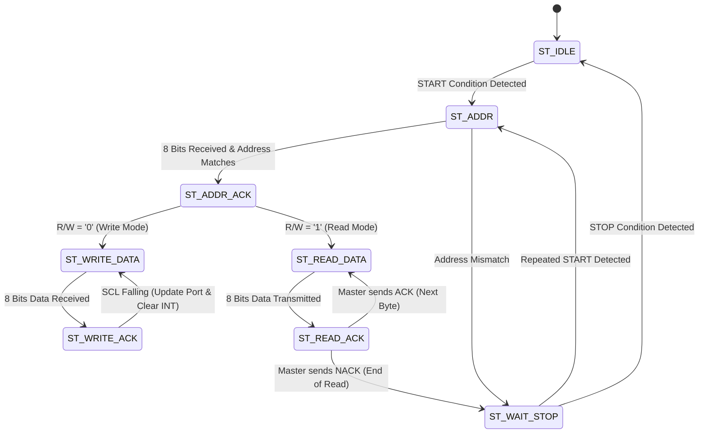

# PCF8574 / PCF8574A Remote 8-Bit I2C I/O Expander in VHDL
## Complete Hardware Design, Simulation & FPGA Bring-Up Report

---

## 1. Introduction & Overview

The **PCF8574** (and its sister variant **PCF8574A**) originally designed by NXP Semiconductors (formerly Philips) is a widely used **Remote 8-Bit I/O Expander** controlled serially over the **I2C bus** at speeds up to **100 kHz (Standard Mode)** and **400 kHz (Fast Mode)**.

This project implements the full digital architecture of the PCF8574 / PCF8574A from scratch in synthesizable **VHDL-93**, verified both in **GHDL simulation** and on **real FPGA hardware** (**Sipeed Tang Nano 20K**, Gowin `GW2AR-LV18QN88C8/I7`).

### Core Specifications
* **Quasi-Bidirectional I/Os (`P0`–`P7`):** 8 I/O pins usable directly as inputs or outputs without a separate Data Direction Register (DDR).
* **Open-Drain Interrupt Output (`INT_N`):** Active-low open-drain interrupt that alerts the host microcontroller on any state change across input-configured pins, eliminating continuous I2C polling.
* **Hardware Address Selection (`A0`, `A1`, `A2`):** 3 hardware address pins supporting up to 8 devices per prefix on the same I2C bus:
  * **PCF8574:** Fixed prefix `"0100"` (7-bit address range `0x20`–`0x27`).
  * **PCF8574A:** Fixed prefix `"0111"` (7-bit address range `0x38`–`0x3F`).
  * Combining both variants allows up to 16 expanders (128 I/O pins) on a single 2-wire I2C bus.
* **Metastability-Safe Input & Reset Conditioning:**
  * Dedicated **2-FF CDC synchronizer** (`sync_ff1 -> sync_ff2`) ahead of the digital glitch filter on all external inputs (`SCL`, `SDA`, `P0–P7`).
  * **2-FF Reset Synchronizer** (asynchronous assert, synchronous deassert) for clean recovery/removal timing.

---

## 2. Architectural Block Diagram

```text
                       +---------------------------------------------------------+
                       |                      PCF8574 / A                        |
                       |                                                         |
      SCL ------------>| [2-FF Sync + Glitch Filter] ---> SCL Edge Detector      |
      SDA <----------->| [2-FF Sync + Glitch Filter] ---> START / STOP Detector  |
                       |                                  Shift Reg & I2C FSM    |
                       |                                           |             |
  A0, A1, A2 --------->| [7-Bit Address Matcher] <-----------------+             |
                       |   (0100 or 0111 prefix)                   |             |
                       |                                           v             |
                       |                                +---------------------+  |
                       |                                | Port Register (8-b) |  |
                       |                                +---------------------+  |
                       |                                           |             |
                       |                                           v             |
  P0 - P7  <---------->| <--- [Quasi-Bidirectional Open-Drain + 0->1 Boost] <----+
                       |                       |                   |             |
                       |                       v                   |             |
                       |            [Input Change Detector]        |             |
                       |                       |                   |             |
                       |                       v                   |             |
  INT_N    <-----------| <--- [Active-Low Open-Drain INT Latch] ---+             |
                       |                                                         |
  CLK / RST_N -------->| [2-FF Reset Synchronizer] (POR Default: 0xFF)           |
                       +---------------------------------------------------------+
```

---

## 3. Detailed Functional Analysis

### A. Quasi-Bidirectional I/Os (`P0`–`P7`)
1. **Writing Logic `'0'` (Output LOW):**
   * Enables the internal low-side driver (`port_drive_low(i) = '1'`), pulling the pin strongly to `GND` (current sinking).
2. **Writing Logic `'1'` (Input Mode / High-Z):**
   * Disables the low-side driver and releases the pin to High-Z (`'Z'`), relying on the pull-up to hold the pin HIGH.
   * An external switch or driver can safely pull the pin to `'0'` without bus contention.
   * Reading the port via I2C samples the **actual physical voltage** on the pin (after 2-FF synchronization and glitch filtering).
3. **Optional `0 → 1` Transient Fast-Rise Boost (`ENABLE_RISE_BOOST`):**
   * Models the NXP PCF8574's transient high-current pull-up on `0 → 1` transitions (~260 ns at 27 MHz) to charge breadboard and LCD capacitance crisply before releasing to High-Z.
4. **Power-On Reset (POR):**
   * All port register bits initialize to `'1'` (`0xFF`), placing all 8 pins in safe High-Z input mode at startup.

### B. Interrupt Generation & Clearing Logic (`INT_N`)
1. **Output Type:** Active-low open-drain (`'0'` when asserted, `'Z'` when deasserted; requires a 4.7 kΩ–10 kΩ pull-up to `VDD`).
2. **Assertion Condition:**
   * Triggered whenever any pin configured as an input (`port_reg(i) = '1'`) differs from the stored `port_snapshot(i)` baseline.
3. **Datasheet-Compliant Clearing Conditions:**
   * **Case 1 (Pin Reversion):** If the external pin returns to its baseline state before being read, `INT_N` deasserts automatically.
   * **Case 2 (Read Cycle):** Cleared during an I2C Read ACK on the rising edge of `SCL`, updating `port_snapshot` to the newly sampled port state.
   * **Case 3 (Write Cycle):** Cleared during an I2C Write ACK on the falling edge of `SCL`, updating `port_snapshot` to the newly written data.

---

## 4. I2C Slave Finite State Machine (FSM)



---

## 5. Project File Structure

| File | Path | Description |
| :--- | :--- | :--- |
| `pcf8574_pkg.vhd` | `rtl/` | VHDL package with address prefix constants, POR defaults, FSM types, and component declarations |
| `i2c_filter.vhd` | `rtl/` | Dedicated 2-FF CDC synchronizer (`sync_ff1 -> sync_ff2`) + digital glitch filter (`FILTER_DEPTH`) |
| `pcf8574_core.vhd` | `rtl/` | Core I2C slave FSM, 7-bit address matcher, quasi-bidirectional port latch, and interrupt engine |
| `pcf8574.vhd` | `rtl/` | Pure, board-agnostic PCF8574 IC top-level with 2-FF reset synchronizer and optional `0 → 1` rise boost |
| `pcf8574_tang20k_top.vhd` | `fpga/tang_nano_20k/` | Sipeed Tang Nano 20K board wrapper (internal POR + 6 onboard diagnostic LEDs) |
| `tang_nano_20k.cst` | `fpga/tang_nano_20k/` | Physical pinout constraints for `GW2AR-LV18QN88C8/I7` |
| `tang_nano_20k.sdc` | `fpga/tang_nano_20k/` | 27 MHz clock and asynchronous I/O timing constraints |
| `pcf8574_tb.vhd` | `tb/` | Self-checking VHDL testbench covering 10 verification scenarios |
| `run_sim.ps1` / `.bat` | `sim/` | Automated GHDL build, simulation, and VCD waveform generation scripts |
| `arduino_test_suite.ino` | `sw/arduino_test_suite/` | Arduino Uno hardware verification suite (address scan, 100/400 kHz, streaming, read-back) |
| `arduino_lcd_demo.ino` | `sw/arduino_lcd_demo/` | Clean 1602 Character LCD live display demo over I2C |

---

## 6. Verification Results

### A. GHDL Self-Checking Simulation (10 / 10 Passed)

```text
==========================================================
   STARTING PCF8574 / PCF8574A COMPREHENSIVE TESTBENCH   
==========================================================
TEST 1: Checking Power-on Reset Defaults...
TEST 1: PASSED (All ports 0xFF, INT_N = '1').

TEST 2: Testing Address Rejection (sending non-existent address 0x27)...
TEST 2: PASSED (Non-matching address ignored).

TEST 3: Testing I2C Write byte 0xAA to PCF8574 (Address 0x20)...
TEST 3: PASSED (Port correctly updated to 0xAA).

TEST 4: Testing Quasi-Bidirectional behavior...
Read back value from port: 208 (0xD0)
TEST 4: PASSED (Quasi-bidirectional input reading verified).

TEST 5: Testing Interrupt Generation upon external input change...
Applying falling edge to Pin 3 (button press)...
TEST 5: PASSED (INT_N correctly asserted LOW).

TEST 6: Testing Interrupt Clearing during I2C Read...
TEST 6: PASSED (INT_N correctly cleared on Read).

TEST 7: Testing Interrupt Clearing on Pin Reversion...
TEST 7: PASSED (INT_N deasserted on reversion).

TEST 8: Testing Interrupt Clearing on I2C Write...
TEST 8: PASSED (INT_N cleared on Write).

TEST 9: Testing PCF8574A variant (Address 0x39)...
TEST 9: PASSED (PCF8574A variant responded correctly).

TEST 10: Testing Repeated START condition...
TEST 10: PASSED (Repeated START handled seamlessly).

==========================================================
   ALL 10 VERIFICATION TESTS COMPLETED SUCCESSFULLY!      
==========================================================
```

### B. FPGA Synthesis, Place & Route, and Real Hardware Bring-Up
Synthesized in **Gowin EDA V1.9.11.03** targeting **Sipeed Tang Nano 20K (`GW2AR-LV18QN88C8/I7`)** with `tang_nano_20k.sdc`:
* **Pure IP Core (`pcf8574`):** 114 LUT4 (< 1%), 108 Flip-Flops (< 1%), 0 latches.
* **Full Board Top (`pcf8574_tang20k_top`):** 320 LUT4 (2%), 253 Flip-Flops (2%), 0 latches, 0 synthesis warnings, timing closed at 27 MHz.
* **Hardware Test (Arduino Uno + Tang Nano 20K + 1602 LCD):**
  * Strict 7-bit hardware address decode verified (`0x20` only).
  * 100 kHz Standard Mode & 400 kHz Fast Mode write/read-back verified.
  * Multi-byte consecutive streaming verified.
  * Quasi-bidirectional external input sensing verified (`P1` tied to GND via LCD `RW` accurately read back as `0`).
  * Live 4-bit 1602 Character LCD text & counter verified on hardware.

---

## 7. Toolchain Compatibility

The RTL is **100% synthesizable synchronous VHDL-93** with zero vendor-locked primitives inside `rtl/`, making it directly portable across:
* **Gowin EDA** (verified on hardware — Tang Nano 20K)
* **AMD / Xilinx Vivado**
* **Intel / Altera Quartus Prime**
* **Lattice Radiant / Diamond**
* **GHDL / QuestaSim / ModelSim / Riviera-PRO**
